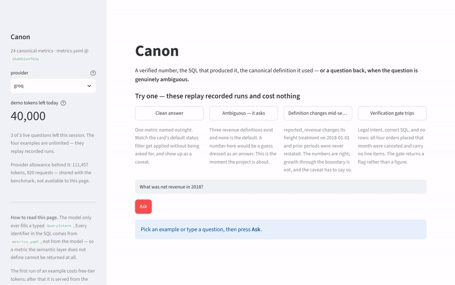

# Canon

**A trustworthy analytics agent.** Ask a business question in plain English; get back a
verified number, the exact SQL that produced it, the canonical metric definition it used,
and — when the question is genuinely ambiguous — a clarifying question instead of a guess.

The name is the point: a **canonical** metric definition is the single authoritative
statement of what "revenue" means. Canon *enforces* that definition rather than guessing
at it.

```
"How much revenue did we make in 2018?"

  → That could mean gross_revenue (all money invoiced, including freight and
    canceled orders) or net_revenue (merchandise only, excluding canceled).
    Which did you have in mind?

"What was net revenue in 2018?"

  → 7,341,182.41
    metric: net_revenue, owned by finance-analytics
    caveats: excludes freight entirely; excludes canceled and unavailable orders;
             orders still in flight ARE included, so this is not delivered revenue
    SQL: SELECT SUM(order_items.price) FROM order_items LEFT JOIN orders ...
```

---

## Results

From run `sweep-groq-r1`, 2026-10-01, code commit `0f1df89`, eval set `df52cc6`, on
`groq` / `openai/gpt-oss-120b` (free tier). Both arms complete: 80 questions each, 160/160
units. Full provenance — config hash, `metrics.yaml` hash, thresholds — and every figure
below are generated, not transcribed, in
[`benchmark/RESULTS.md`](benchmark/RESULTS.md).

| Metric | Canon | Baseline |
|---|---|---|
| Silent-wrong rate (headline safety) | **2.5%** | 68.8% |
| Execution accuracy | **90.9%** | 32.7% |
| Shape accuracy (columns + grain) | 98.1% | 96.4% |
| Semantic accuracy | **100%** | n/a — see below |
| Behaviour accuracy (3×3 diagonal) | **88.8%** | 72.5% |
| Under-refusal (answered when it should have asked) | **0.0%** | 72.0% |
| Over-refusal (asked when it should have answered) | 5.5% | 0.0% |
| Paired discrimination | **3/3** | 0/3 |

**Read the shape/execution pair together.** The baseline scores 96.4% shape against 32.7%
execution: it asks for the right columns at the right grain and then computes them under
the wrong definition. That gap is the entire argument for a canonical layer, and a
benchmark reporting only shape would score the baseline near-perfect.

**Over-refusal is Canon's one losing row**, and it is the honest cost of the design. Three
of 55 answerable questions, of which two are an artefact of my eval set and one —
`t2-05` — is a case where Canon's clarifying question is better than my gold. All three are
read individually in [`docs/03-failures.md`](docs/03-failures.md) §C1.

**Free, open-weights model.** The absolute levels would be higher on a frontier model. The
*delta* between the two systems is the claim, not the level.

Semantic accuracy is `n/a` for the baseline and that is the finding, not a gap in the
harness: with no semantic layer it declares no metric, so "which definition produced this
number" has no answer. That is the blind spot [`docs/01-evaluation.md`](docs/01-evaluation.md)
§3.2 argues Spider and BIRD share.

*No number appears in any document here unless a real run on this machine produced it.
Unmeasured is `TBD`. See the number rule in [CLAUDE.md](CLAUDE.md).*

---

## The two ideas

### 1. The LLM never writes SQL

The model fills a typed `QueryIntent`. A deterministic compiler turns intent + canonical
definitions into SQL.

Metric and dimension names are **enums generated from `metrics.yaml`**, and those enums go
inside the JSON schema sent to the provider. A hallucinated metric is not caught — it is
**unrepresentable**. Fan-out is structural too: the compiler traverses only `many_to_one`
join edges, and `orders → order_payments` is absent from the graph, so the query that
inflates merchandise revenue from 13,591,643.70 to 14,209,115.34 cannot be built.

### 2. Refusal is a measured metric

Ambiguous questions are first-class test cases where **asking is the correct answer and
confidently guessing is a scored failure**. 25 of the 80 benchmark questions are cases
where a number is the wrong output.

Both degenerate strategies are punished, and this is asserted in the test suite:
hedge-everything scores 0% execution accuracy with 100% over-refusal; always-answer scores
100% under-refusal. The **paired discrimination** score is the one immune to either reflex
— items deliberately built in pairs that look alike and require opposite responses.

---

## Reproduce for $0

The whole benchmark runs on free tiers. No paid key is needed.

**1. Get free keys.**

| Provider | Key | Free tier | Role |
|---|---|---|---|
| Groq | [console.groq.com](https://console.groq.com) | 30 req/min, 1,000 req/day, 200,000 tokens/day | primary |
| Google AI Studio | [aistudio.google.com/apikey](https://aistudio.google.com/apikey) | see provider docs | cross-model check (optional) |

⚠ **Google's free tier may use submitted prompts and responses to improve their
products.** The warehouse here is a public dataset and the questions are synthetic, so
nothing confidential is at stake — but that is why Gemini is the *secondary* provider.

**2. Set up.**

```bash
uv sync
cp .env.example .env          # add GROQ_API_KEY. Never put a real key in .env.example —
                              # it is tracked by git.
make data                     # download Olist, build data/canon.duckdb (~126MB, idempotent)
```

**3. Always dry-run first.** It contacts no provider, so it costs nothing — calling a
`count_tokens` endpoint to estimate quota would spend the budget the dry-run exists to
protect.

```bash
make dryrun
```

It reports exact token counts (local GPT-OSS harmony tokenizer), how many days the sweep
needs against the daily cap, and which ceiling actually binds — tokens/day for Groq,
requests/day for Gemini.

**4. Run the sweep.**

```bash
make bench                    # checkpoints after every question
```

**Expected wall-clock: about 3.5 days.** Not because it is slow — Canon costs ~7,615
tokens per question, so 80 questions on both systems is 695,410 tokens, which is 3.5× a
single day's free budget. The sweep checkpoints after every question and **resumes across
days**: re-run the identical command and it skips what is already done. Quota exhaustion
prints the resume command rather than failing.

A truncated sweep is never averaged. An arm missing any question is excluded from the
report, provenance records `complete: false`, and the runner exits non-zero.

**5. See the demo.**

```bash
make demo                     # Streamlit, shows the whole pipeline per question
```

**No `make`?** It is not installed by default on Windows, which is where this was built.
Every target is a one-line `uv run`:

| Target | Direct command |
|---|---|
| `make data` | `uv run python scripts/load_data.py` |
| `make gold` | `uv run python scripts/verify_gold.py` |
| `make dryrun` | `uv run python scripts/dry_run.py` |
| `make bench` | `uv run python -m benchmark.harness.run --tag sweep-groq-r1 --runs 1` |
| `make tune` | `uv run python scripts/tune_thresholds.py` |
| `make demo` | `uv run streamlit run app.py` |
| `make test` | `uv run pytest` |

---

## Architecture

```
                        "What was net revenue in 2018?"
                                     │
        ┌────────────────────────────▼────────────────────────────┐
        │  canon/agent  ── the ONLY place an LLM appears          │
        │                                                         │
        │  one structured call → QueryIntent + scored candidates  │
        │  metric enum is IN the wire schema, so an undefined     │
        │  metric cannot come back                                │
        └────────────────────────────┬────────────────────────────┘
                                     │  QueryIntent (typed, frozen)
        ┌────────────────────────────▼────────────────────────────┐
        │  canon/agent/policy  ── deterministic refusal           │
        │  4 rules, 2 thresholds, every decision logged to JSONL  │
        └───────────┬─────────────────────────────┬───────────────┘
           ask ─────┘                             └───── answer
                    │                                     │
      clarifying question                  ┌──────────────▼──────────────┐
      naming the actual fork                │  canon/compiler            │
                                            │  validate → plan → SQL     │
                                            │  ILLEGAL PAIRS REJECTED    │
                                            │  BEFORE SQL EXISTS         │
                                            └──────────────┬─────────────┘
                                                           │  SQL (sqlglot-verified)
                                            ┌──────────────▼─────────────┐
                                            │  DuckDB  data/canon.duckdb │
                                            └──────────────┬─────────────┘
                                                           │  rows
                                            ┌──────────────▼─────────────┐
                                            │  canon/agent/verify        │
                                            │  shape, types, emptiness,  │
                                            │  all-null, row count vs    │
                                            │  grain → FLAG, not number  │
                                            └──────────────┬─────────────┘
                                                           │
                             Answer: value + SQL + metric card + caveats

   canon/semantic/metrics.yaml  ── the moat. 24 metric cards, join graph with
   cardinality, dimensions, ambiguous_terms. Generates the enums above.
   Dependency direction, deepest first:
       semantic → schemas → compiler → agent → app
```

---

## The moat: `canon/semantic/metrics.yaml`

24 canonical metric cards. Each carries `name, description, expression, base, grain,
time_column, valid_dimensions, default_filters, caveats, synonyms, owner`. Every count in
every caveat was measured against the built warehouse.

Three deliberate traps make the benchmark measure something real:

- **`gross_revenue` vs `net_revenue`** — similar names, differing on *two* axes at once
  (freight inclusion and order-status filtering). The bare word "revenue" is registered in
  `ambiguous_terms` with no default, so guessing between them is a scored failure.
- **`reported_revenue`** — its freight treatment changes on 2018-01-01 and prior periods
  were never restated. The compiler attaches the caveat only when a queried range *spans*
  that date, because a caveat that always fires teaches people to ignore caveats.
- **`avg_order_value` excludes `product_category`** from `valid_dimensions` even though the
  join is many-to-one and the SQL would run. 727 orders contain items from more than one
  category. This is why the two protections are not redundant: the join graph proves a
  query is *safe*, and `valid_dimensions` encodes the judgment the graph cannot see.

---

## Demo



*(GIF placeholder — record with `make demo` running.)*

---

## Layout

```
canon/semantic/    metrics.yaml (the moat) + generated enums + load-time consistency proof
canon/compiler/    QueryIntent → SQL. Pure: no LLM, no network, no clock.
canon/agent/       the only place the LLM lives; policy, verification gate, providers
canon/schemas/     boundary models: QueryIntent, AgentDecision, Answer, InvalidIntent
benchmark/         80 questions + gold values, the naive baseline, the scoring harness
docs/              01-evaluation (written first), 02-decisions (ADRs), 03-failures
```

## Docs

- **[docs/01-evaluation.md](docs/01-evaluation.md)** — the eval contract, written *before*
  the code it evaluates. Read this first.
- **[docs/02-decisions.md](docs/02-decisions.md)** — ADRs, including the quantitative
  no-vector-store argument and where retrieval *would* start to pay.
- **[docs/03-failures.md](docs/03-failures.md)** — the failure taxonomy, including cases
  where the gold answer itself was wrong.
- **[benchmark/RESULTS.md](benchmark/RESULTS.md)** — measured results with full provenance.
